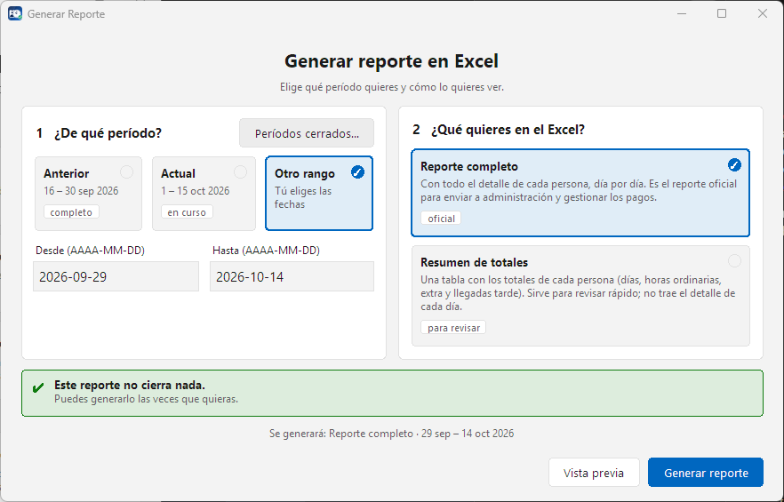
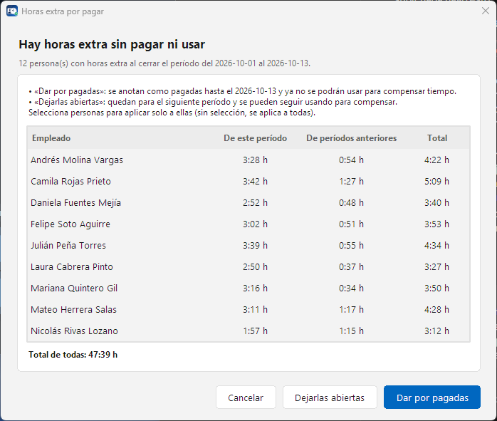

# A Tiempo

**A Tiempo** es un programa para Windows que controla la asistencia del personal: registra la entrada y la salida de cada empleado, y entrega reportes claros en Excel. Funciona sin internet y los datos se guardan solo en el computador de la empresa.

## Descargar

Ve a la sección [**Releases**](../../releases/latest) y baja el instalador que corresponda a tu Windows:

| Archivo | Para |
|---|---|
| `Instalador_ATiempo_x64.exe` | Windows de 64 bits (lo normal en equipos de los últimos años) |
| `Instalador_ATiempo_x86.exe` | Windows de 32 bits y Windows 7 |

Cada release trae un archivo `SHA256SUMS.txt` para comprobar que la descarga no se corrompió.

> Si Windows muestra el aviso de SmartScreen, pulsa **Más información › Ejecutar de todas formas**.

## Así se ve

*Capturas con datos de ejemplo (personas inventadas).*

### A tu gusto

Varios modos de apariencia, colores a elegir y letra ajustable: claro, oscuro, alto contraste o personalizado.

<table align="center">
  <tr>
    <td align="center"> <b>Claro</b></td>
    <td align="center"> <b>Oscuro</b></td>
    <td align="center"> <b>Alto contraste</b></td>
  </tr>
  <tr>
    <td align="center"> <b>Personalizado</b></td>
    <td align="center"> <b>Acento verde</b></td>
    <td align="center"> <b>Acento morado</b></td>
  </tr>
</table>

### El día a día

&nbsp;

&nbsp;

### Reportes y estadísticas

&nbsp;

## Qué ofrece

- Registro de entrada y salida con lector de códigos, tarjeta o de forma manual.
- Seguimiento diario del personal, por turno.
- Ausencias, permisos, domingos y festivos.
- Reportes en Excel y estadísticas.
- Respaldos y restauración guiada.
- Varios temas de apariencia y avisos dentro del programa.
- Tickets de soporte dentro del programa, como una conversación.

## Instalación y actualización

1. Ejecuta el instalador y sigue los pasos.
2. Abre A Tiempo y configúralo desde **Configuración**.
3. Cuando hay una versión nueva, A Tiempo avisa y se actualiza en el mismo lugar **sin tocar tus datos**.

## Requisitos

- Windows 7 o superior (32 o 64 bits).
- No necesita internet para el uso diario.

## Privacidad

Los datos del personal se guardan **únicamente en el equipo donde está instalado el programa**. Lo único que sale del equipo es lo que decides enviar al soporte y la consulta de actualizaciones.

## Soporte

Dentro del programa: **Configuración › Soporte**.

## Estado del proyecto

Software de uso comercial con licencia. Este repositorio publica los instaladores y las notas de cada versión.
