# A Tiempo

**A Tiempo** es un programa para Windows que controla la asistencia del personal: registra la entrada y la salida de cada empleado, calcula llegadas tarde, horas extra, domingos y festivos, y genera el reporte en Excel. Funciona sin internet y los datos se guardan solo en el computador de la empresa.

## Descargar

Ve a la sección [**Releases**](../../releases/latest) y baja el instalador que corresponda a tu Windows:

| Archivo | Para |
|---|---|
| `Instalador_ATiempo_x64.exe` | Windows de 64 bits (lo normal en equipos de los últimos años) |
| `Instalador_ATiempo_x86.exe` | Windows de 32 bits y Windows 7 |

Cada release trae un archivo `SHA256SUMS.txt` para comprobar que la descarga no se corrompió.

> Si Windows muestra el aviso de SmartScreen, pulsa **Más información › Ejecutar de todas formas**.

## Así se ve

*Capturas con datos de ejemplo (empleados inventados).*

### Para todos los gustos: modos de apariencia

Claro, oscuro, **alto contraste** (para leer sin esfuerzo) o **personalizado** con tus dos colores. Además puedes elegir el color de acento y el tamaño de la letra. El programa ajusta solo los colores para que el texto siempre se lea bien.

<table align="center">
  <tr>
    <td align="center">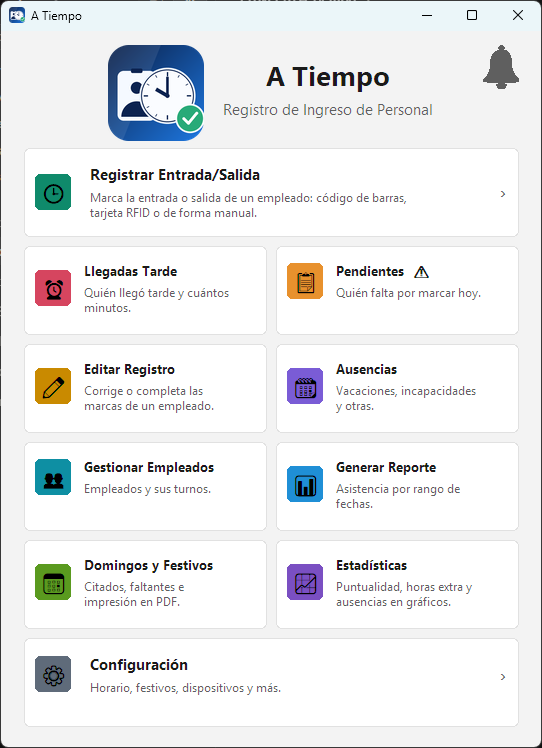 <b>Claro</b></td>
    <td align="center">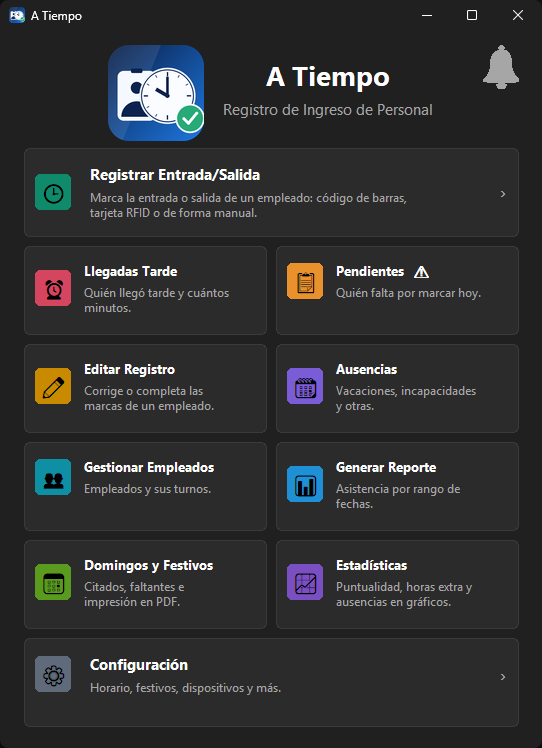 <b>Oscuro</b></td>
    <td align="center">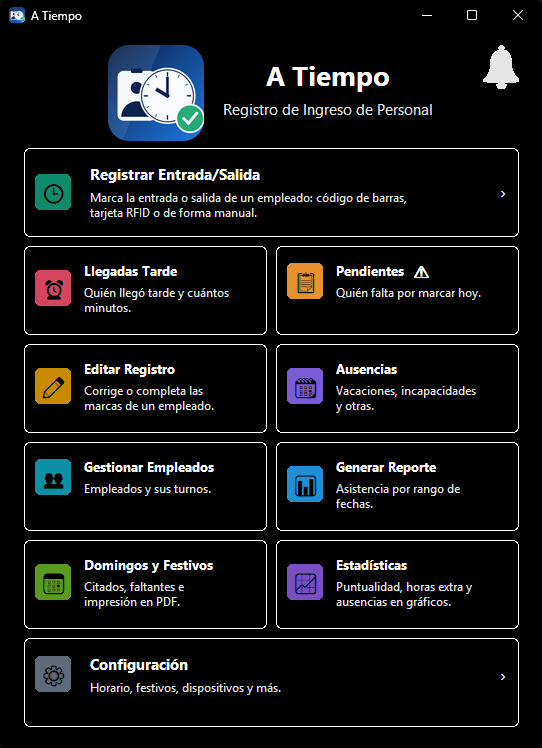 <b>Alto contraste</b></td>
  </tr>
  <tr>
    <td align="center">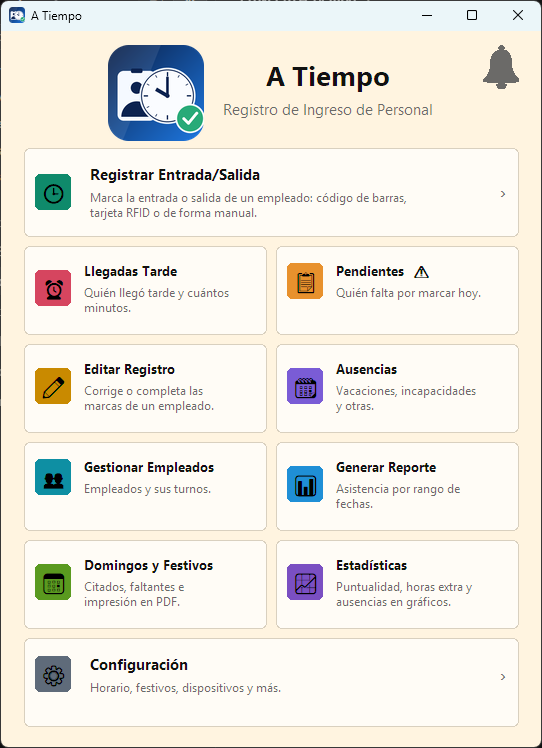 <b>Personalizado</b> (tus dos colores)</td>
    <td align="center">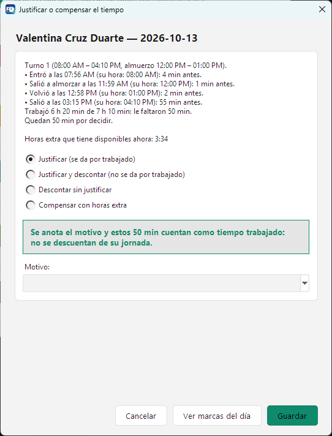 <b>Acento verde</b> (modo claro)</td>
    <td align="center">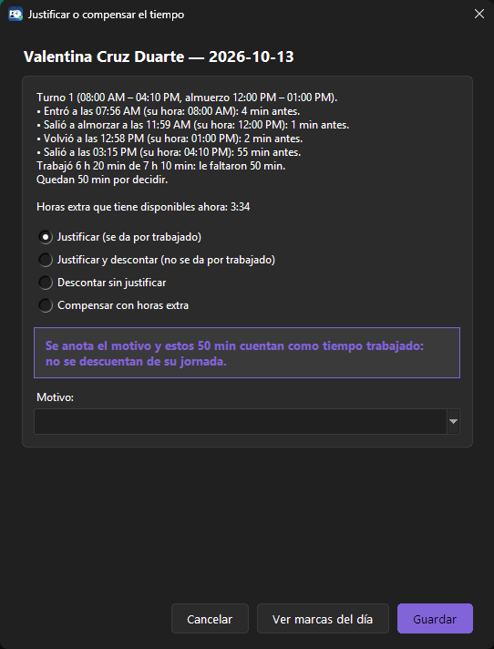 <b>Acento morado</b> (modo oscuro)</td>
  </tr>
</table>

### El día a día

**Registrar entrada y salida** con lector de código de barras, tarjeta RFID o de forma manual:

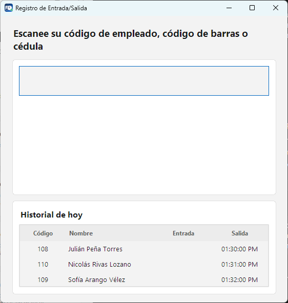

**Control del día (Pendientes)**: quién falta por marcar, los cambios de turno, lo que hay que confirmar y quién está ausente, todo en un solo lugar y por turno. También en modo oscuro:

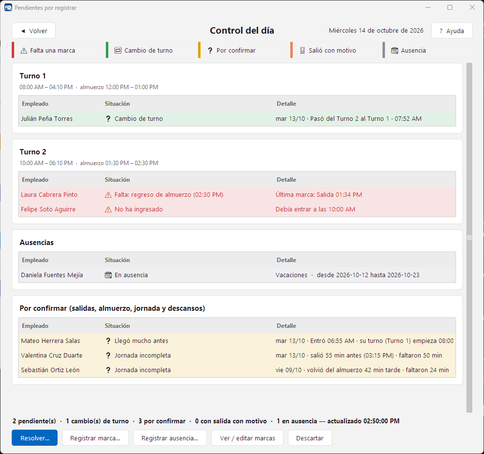&nbsp;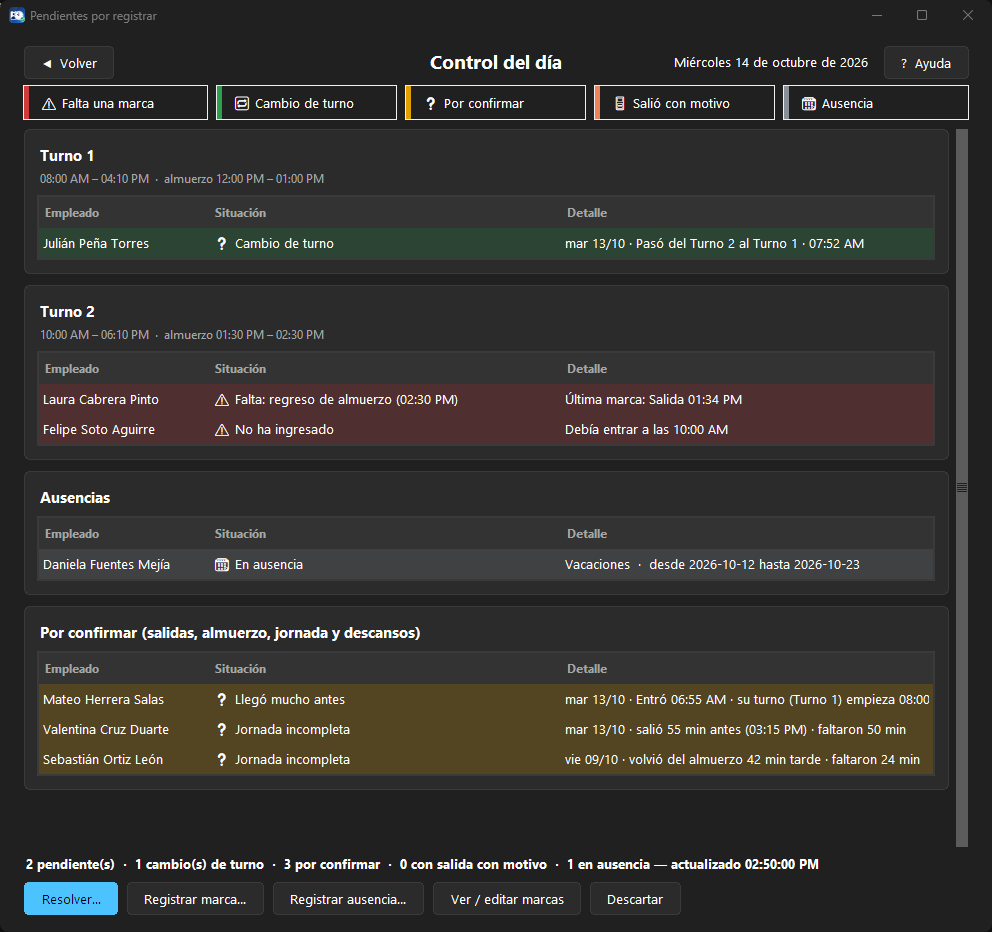

**Cambio de turno y llegadas muy temprano**: el programa explica qué pasó (turno asignado, a qué hora entró, con qué turno coincide, lo que hizo ese día) y deja elegir qué turno cuenta. Los avisos no se pierden al terminar el día y se resuelven solos cuando la salida lo aclara:

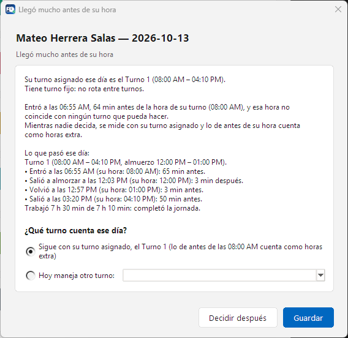

**Llegadas tarde**: quién llegó tarde y cuánto, con el tiempo que queda por decidir:

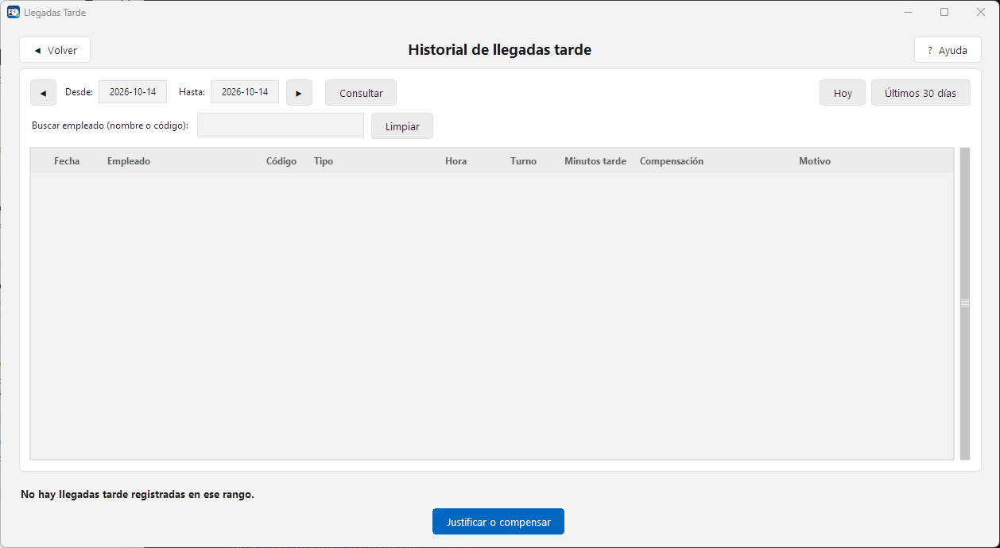

**Justificar o compensar**: nada se descuenta ni se justifica solo. Cada tiempo sin cubrir lo decide una persona: justificar, justificar y descontar, descontar o compensar con horas extra que ya tenía:

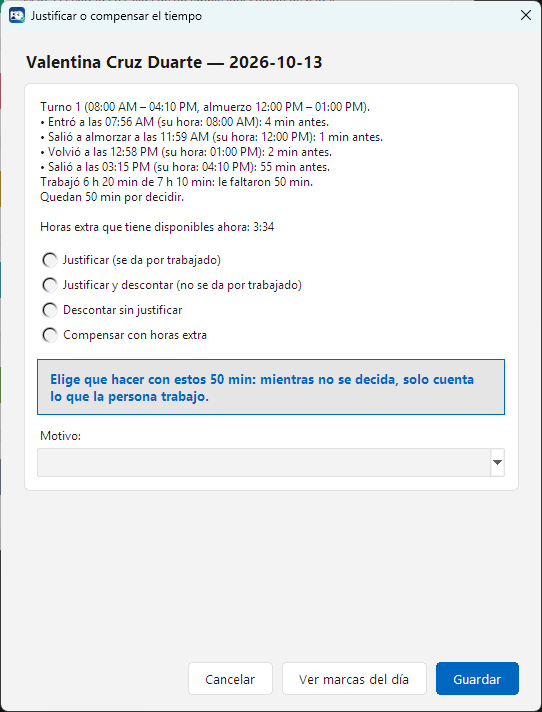

**Ausencias y permisos**: vacaciones, incapacidades, permisos por horas y otras, con avisos en la campanita antes de que terminen:

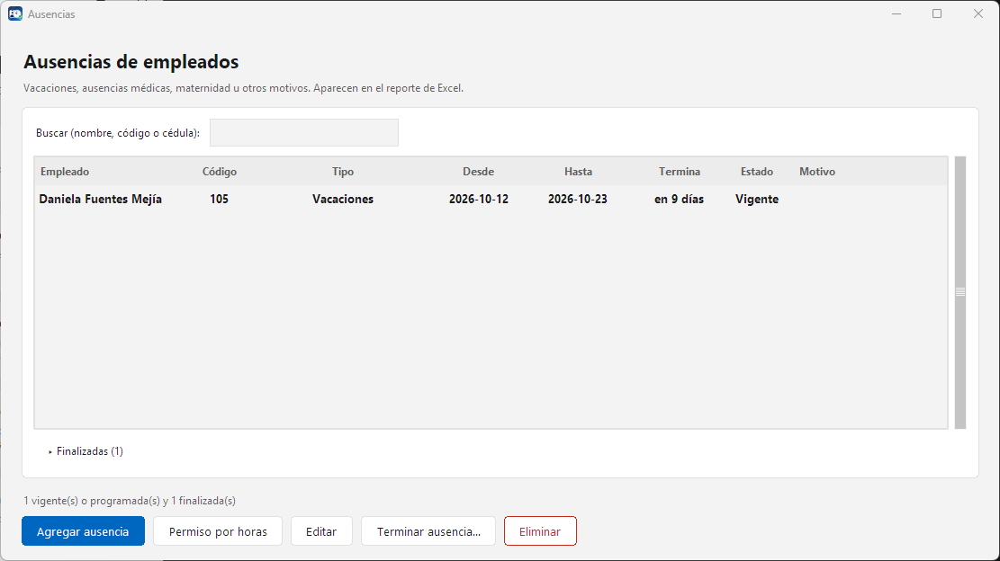

**Empleados y turnos** (fijos, rotativos y de apoyo) y **corrección de marcas** cuando alguien olvida marcar:

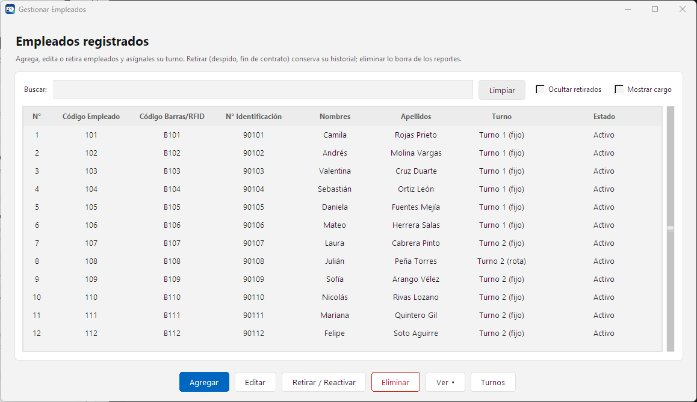&nbsp;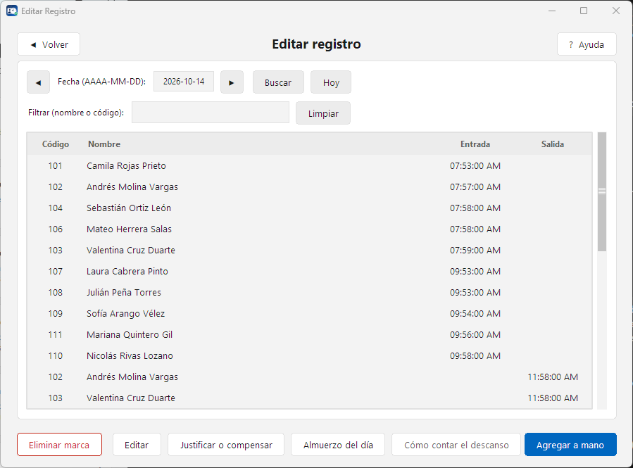

**Estadísticas** para ver cómo va el personal de un vistazo: puntualidad, llegadas tarde, horas extra y ausencias:

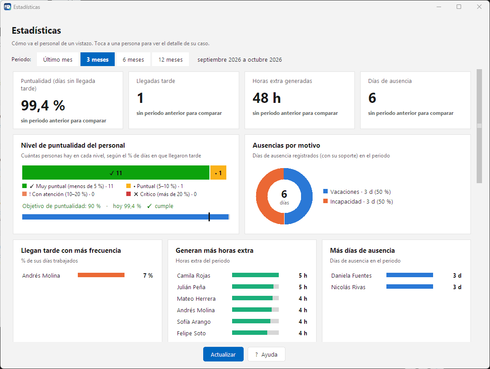

**Configuración** por categorías: horario, márgenes, festivos, marcación, reportes, respaldos y apariencia:

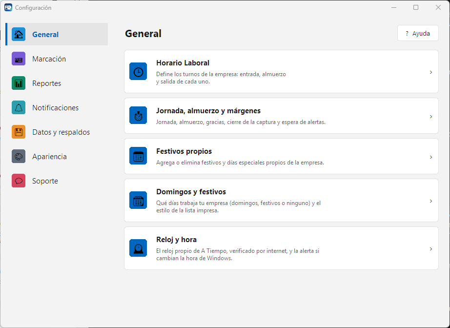

## Qué hace

- **Marcación** de entrada y salida por código, código de barras, lector RFID o número de identificación, con foto opcional y confirmación por voz.
- **Pendientes del día** por turno: marcas que faltan, cambios de turno, llegadas muy temprano, salidas con motivo y jornadas incompletas.
- **Decisiones con una persona al mando:** el tiempo que no se cubrió se justifica, se descuenta o se compensa con horas extra, siempre eligiéndolo alguien, con el motivo anotado.
- **Turnos fijos, rotativos y de apoyo**, con detección del cambio de turno según la hora de llegada.
- **Editar registro** para corregir o completar las marcas de un empleado.
- **Ausencias** (vacaciones, incapacidades, permisos por horas y otras) con avisos en la campanita.
- **Domingos y festivos:** lista de citados, faltantes e impresión en PDF con varios estilos; se puede indicar si la empresa los trabaja o no.
- **Reporte de Excel** por rango de fechas, con una hoja por empleado (semana por semana, con las notas y decisiones de cada día y de dónde sale cada cifra), logo y colores de la empresa.
- **Estadísticas** de puntualidad, horas extra y ausencias.
- **Gestión de empleados** y turnos.
- **Respaldos automáticos** y copias externas (USB o nube), con restauración guiada.
- Temas claro, oscuro, de alto contraste y personalizado, color de acento y tamaño de letra ajustable.
- Se **repara solo** si la base de datos viene de una versión vieja, y avisa si falta o se dañó.

## Instalación y actualización

1. Ejecuta el instalador y sigue los pasos.
2. Abre A Tiempo y configura el horario y los empleados desde **Configuración**.
3. Cuando hay una versión nueva, A Tiempo avisa y se actualiza en el mismo lugar **sin tocar tus datos** (antes crea un respaldo automático).

## Requisitos

- Windows 7 o superior (32 o 64 bits).
- No necesita internet para el uso diario; solo para buscar actualizaciones.

## Privacidad

Las marcaciones, los datos de los empleados y las fotos se guardan **únicamente en el equipo donde está instalado el programa**. El programa no envía datos de asistencia a ningún servidor. Lo único que sale del equipo es lo que el usuario decide enviar a soporte (por ejemplo, una nota o el paquete de diagnóstico) y la consulta de actualizaciones.

## Soporte

Dentro del programa: **Configuración › Soporte** (ayuda, notas de la versión y paquete de diagnóstico).

## Estado del proyecto

Software de uso comercial con licencia. Este repositorio publica los instaladores y las notas de cada versión.
